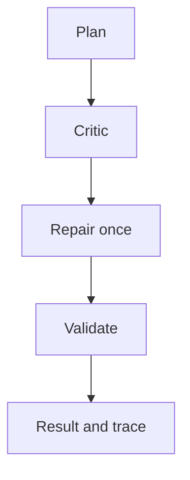

# X-Loop · Validation workflow

A deterministic demonstration of plan–critic–repair–validate (PCRV) for a fictional task brief. It illustrates role separation, bounded repair and traceability without using a model, external API or private orchestration architecture.

## Flow


```sh
python workflow.py
python -m unittest discover -v
```

The demo checks whether a brief has an objective, acceptance criterion and owner. Missing values receive explicit draft placeholders, never invented claims of completion. A repaired brief still requires human review.

## Português
Exemplo educacional de separação de papéis, crítica, reparo limitado e validação. Não implementa agentes autônomos nem contém o núcleo privado da pesquisa.

AI-assisted implementation, human-directed design. No dependencies beyond Python 3.10+.
